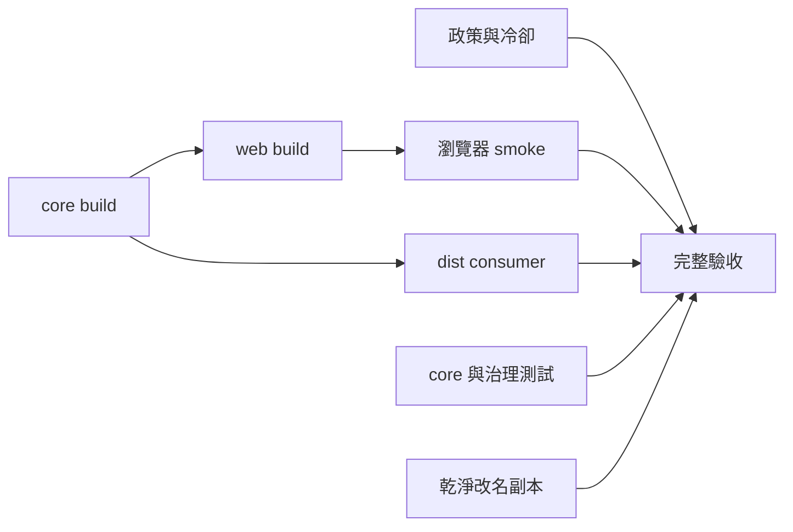

# 架構

`apps/web` 是可執行應用程式，透過 `workspace:*` 使用 `@starter/core`。`packages/core` 只包含純 TypeScript 邏輯；不能引用 app。consumer 只讀 core 的 `dist/index.mjs` 與 `dist/index.d.mts`，在 workspace 外驗證公開 exports 與負向型別案例。

root 共用嚴格 TS、lint 與 format。Vite+ 的 Vite alias、Vitest 與必要 peer 配對由官方 bundle metadata 推導；不獨立升級內部工具。TypeScript 7 是穩定版，但 tsdown 仍提示宣告 API 支援為 experimental，必須持續以實際宣告與 consumer 驗收。

`vp run --no-cache` 是最終驗收入口。一般 build 可快取；網路、時間、安全情報、smoke 與有副作用的任務關閉快取。必要 filters 使用 `--fail-if-no-match`，Vitest 禁止空測試成功。

供應鏈政策集中在 workspace，可信 policy 比對 exact versions、strict、typeAware/typeCheck 與安裝 allowlist。`trustLockfile: false` 讓現有 lockfile 仍接受發布時間檢查。production audit 使用 npm registry advisory 資料；它無法證明不存在惡意套件。

可信 controller 與候選程式碼分開。候選依賴／測試不取得寫入憑證；Pi 只有有上限的 broker capability。真實模型 key 留在 broker，App private key 留在可信 controller。候選 container 沒有網路、主機 Git metadata、Docker socket 或主機 HOME；Pi 透過受限工具讀取候選 source。

Pi 只能輸出現有允許路徑的 source patch，不能改測試、strict、workflow、controller、政策或 allowlist。獨立發布步驟再次檢查原 HEAD、檔案型態與 diff，再由 App 原子提交。新 HEAD 必須重新通過全部 CI。

新增 workspace package 時，同步擴充 `vp run` 相依圖、測試範圍、`sync-toolchain.mjs` 的 manifest 清單與受保護 updater 路徑，再以完整驗收確認新的 package 邊界。自動修復的 source allowlist 也需明確審查。
